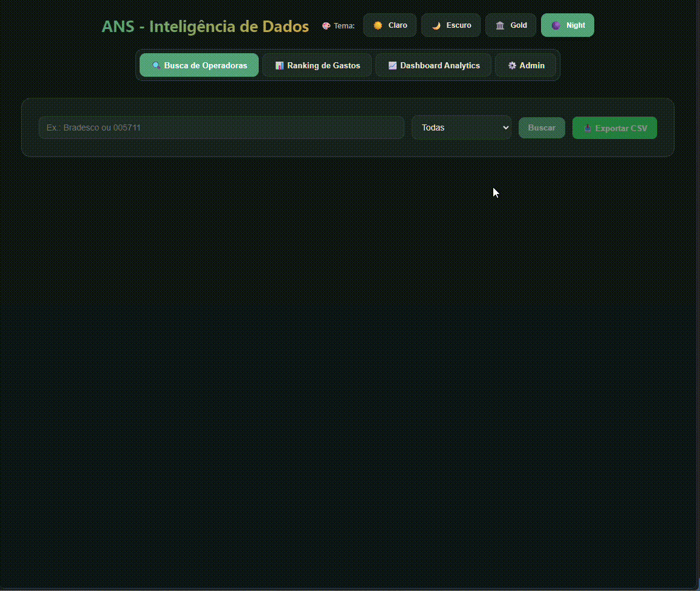
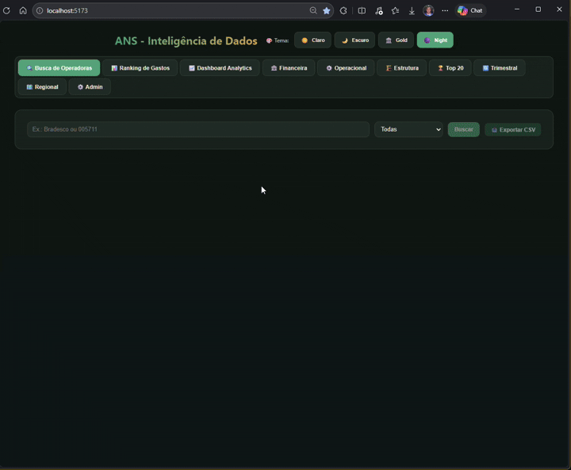
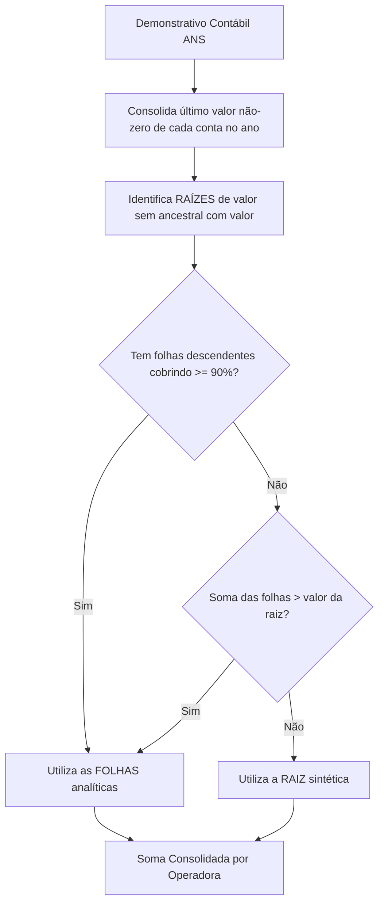

# 🏥 ANS Intelligence

Aplicação full-stack de **Business Intelligence** para dados abertos da Agência Nacional de Saúde Suplementar (ANS). Permite buscar operadoras de saúde, analisar demonstrações contábeis em múltiplas dimensões (Gastos Assistenciais, Financeira, Operacional e Estrutura), comparar trimestres e sazonalidade, visualizar concentração regional (Heatmap 27 UFs) e exportar relatórios consolidados em PDF e Excel, tudo com metodologia contábil auditável e dados reais.

> **Status:** 🟢 Full-Stack 100% Funcional | 🟢 Multi-Dimensão Contábil (v1.2) | 🟢 82 Testes (74% Cobertura) | 🟢 Pipeline CI/CD GitHub Actions | 🟢 Exportação PDF/Excel & Upload CSV | 🟢 Metodologia D Auditada

---

## 📋 Sumário Executivo

| Métrica / Recurso | v1.0 | v1.1 | v1.2 (Atual) |
| :--- | :--- | :--- | :--- |
| **Dimensões Contábeis** | 1 (Gastos Assistenciais) | 1 (Gastos Assistenciais) | **4 (Gastos, Financeira, Operacional, Estrutura)** |
| **Abas no Dashboard** | 2 abas | 3 abas | **8 abas analíticas integradas** |
| **Total Gastos 2024** | R$ 6.37 Bi | R$ 19.57 Bi *(com lacuna ANS)* | **R$ 19.57 Bi** *(com auditoria quantitativa)* |
| **Total Gastos 2025** | R$ 8.31 Bi | R$ 44.48 Bi *(ano referência)* | **R$ 44.48 Bi** *(ano referência completo)* |
| **Total Gastos 2026** | — | R$ 15.69 Bi *(1T+2T)* | **R$ 15.69 Bi** *(acompanhamento contínuo)* |
| **Metodologia Contábil** | `len(CD_CONTA) == 9` | **Método D (Híbrido)** | **Método D expandido** (prefixos 31, 41, 44, 46, 12, 13, 21, 23, 25) |
| **Análises Avançadas** | Top 10 Básico | Top 10 + Timeline Anual | **Top 20 Multi-Métrica, Trimestral 1T-4T, Outliers IQR, Heatmap 27 UFs** |
| **Exportação de Dados** | CSV simples | CSV com UTF-8 BOM | **PDF Institucional (ReportLab/Matplotlib) + Excel (.xlsx) + CSV** |
| **Filtros Dinâmicos** | Texto simples | Modalidade básica | **Filtros cruzados (Modalidade, UF, Região) com alta legibilidade** |
| **Carga de Dados** | Apenas pipeline fixo | Pipeline dinâmico | **Pipeline automatizado + Upload manual de CSV (drag & drop)** |
| **Suíte de Testes** | Inexistente | Testes iniciais | **82 testes passando (74% de cobertura, gate ≥65% superado)** |
| **Automação & CI/CD** | Manual | Docker Compose | **GitHub Actions (Lint, Testes com gate, Integração MySQL/Redis, Docker build)** |

---

## 📸 Demonstração Visual

### V 1.0 — Busca e Dashboard Inicial


### V 1.2 — Timeline Plurianual e Temas Institucionais


---

## ✨ Funcionalidades Principais

### 🔍 1. Busca e Detalhamento de Operadoras
- **Busca inteligente:** por registro ANS, CNPJ, razão social ou nome fantasia com normalização Unicode (sem distinção de acentos ou maiúsculas/minúsculas).
- **Base indexada:** **1.106 operadoras** ativas mapeadas em memória para resposta instantânea.
- **Paginação completa:** metadados com `page`, `limit`, `total` e `pages`.
- **Filtro por modalidade:** Medicina de Grupo, Cooperativa Médica, Autogestão, Filantropia, etc.
- **Exportação CSV:** download instantâneo com codificação UTF-8 BOM (compatível com Excel brasileiro).

---

### 🏥 2. Gastos Assistenciais (Foco no Sinistro)
- **Top 10 operadoras** com maiores gastos assistenciais no período.
- **Dropdown multi-ano** com indicadores visuais: ✅ Completo, ⚠️ Parcial, ⚠️ Lacuna ANS.
- **Badges de metadata:** `<YearBadge>` indicando status do período selecionado.
- **Disclaimer acadêmico:** `<AcademicDisclaimer>` contextual sobre ressalvas metodológicas da base.
- **Cache client-side por ano:** transições instantâneas entre períodos sem sobrecarga de rede.
- **Visualizações integradas:** Ranking Top 10, Market Share Top 5 vs Outros (Pizza), Evolução Anual, Comparação Temporal agrupada e Curva de Concentração de Pareto (80/20).

---

### 🏦 3. Análise Financeira 360° (v1.2 — F2.1)
- **Métricas estruturais:** Receita com Operações de Planos de Saúde (`31`), Lucro Líquido (`25`), Patrimônio Líquido (`256`), Caixa e Equivalentes (`12`), Obrigações Trabalhistas (`21`) e Fornecedores (`23`).
- **Métricas calculadas em tempo real:**
  - **Sinistralidade (%)**: relação direta `Eventos / Receita` (`41 / 31`).
  - **Endividamento (%)**: relação de passivo de curto prazo sobre caixa/receita (`(21 + 23) / Caixa`).
- **Cards de KPI:** Receita Total, Caixa Consolidado, Lucro Líquido Médio e Sinistralidade Média de Mercado.
- **Gráfico Top 10 por Receita** e tabela completa com drill-down instantâneo.

---

### ⚙️ 4. Análise Operacional (v1.2 — F2.2)
- **Detalhamento de despesas operacionais:** Despesas Administrativas (`46`), Despesas com Pessoal Próprio (`461`), Despesas Judiciais e Contingências (`468`) e Provisões Técnicas (`44`).
- **Identificação de gargalos:** peso relativo dos custos de pessoal e litígios sobre o total de gastos administrativos.
- **KPIs consolidados:** Despesa Administrativa Total, Total de Provisões e Médias do Setor.

---

### 🏗️ 5. Estrutura & Ativos (v1.2 — F2.3)
- **Mapeamento de solidez e infraestrutura:**
  - Imobilizado e Hospitais Próprios (`133`).
  - Goodwill / Ágio por Expectativa de Rentabilidade (`132139013`).
  - Intangível e Marcas (`134`).
  - Sistemas de Computação e Tecnologia da Informação (`134129011`).
  - Carteira de Investimentos (`132`).
- **KPIs dedicados:** Ativo Imobilizado Total, Goodwill Acumulado, Investimento em Tecnologia e Investimentos Financeiros.

---

### 🏆 6. Rankings Top 20 Multi-Métrica (v1.2 — F3.1)
- Cinco sub-rankings dinâmicos alternáveis com um clique:
  1. 💰 **Por Receita:** maiores faturamentos do mercado suplementar.
  2. 🏥 **Por Sinistro:** maiores volumes assistenciais pagos.
  3. 🏛️ **Por Patrimônio Líquido:** maior robustez patrimonial e reservas.
  4. 💵 **Por Caixa e Equivalentes:** operadoras com maior liquidez imediata.
  5. 📈 **Por Lucro Líquido:** operadoras mais rentáveis do exercício.
- Gráfico de barras horizontais acoplado à tabela com drill-down ao clicar na linha.

---

### 🔄 7. Análise Trimestral & Sazonalidade (v1.2 — F3.2)
- **Gráfico agrupado 1T × 2T × 3T × 4T:** visualização da curva sazonal do Top 5 de operadoras.
- **Drill-down individual por operadora:** seletor com busca para analisar uma operadora específica, renderizando sua distribuição trimestral e um gráfico de pizza com percentual de sazonalidade por trimestre.

---

### ⚠️ 8. Detecção Estatística de Outliers (v1.2 — F3.3)
- **Metodologia IQR (Interquartile Range):** detecção estatística de valores discrepantes ($Q_3 + 1.5 \times IQR$ e $Q_1 - 1.5 \times IQR$).
- **Identificação visual:** sinalização automática via badge `⚠️ Outlier` nas tabelas contábeis, destacando desvios atípicos de sinistralidade ou despesas administrativas para auditoria.

---

### 🗺️ 9. Distribuição Regional & Heatmap das 27 UFs (v1.2 — F3.5)
- **Painel visual das 27 UFs:** agrupadas por Macrorregião (Norte, Nordeste, Centro-Oeste, Sudeste, Sul).
- **Intensidade cromática:** escala de calor em tons de azul proporcional ao volume financeiro.
- **Seletor de métrica:** alternância dinâmica entre Gastos Assistenciais, Receita, Caixa e Patrimônio.
- **Ranking estadual:** lista ordenada dos estados com maior participação no mercado de saúde suplementar.

---

### 🔍 10. Filtros Avançados & Acessibilidade Visual (v1.2 — F3.4)
- **Recorte multidimensional:** filtros simultâneos por Modalidade Jurídica, Unidade Federativa (UF) e Região Geográfica.
- **Acessibilidade e legibilidade:** calibragem cromática do texto dos componentes de seleção (`#1e293b`), prevenindo texto invisível em fundos brancos e garantindo contraste WCAG.

---

### 📥 11. Central de Exportação & Relatórios (v1.2 — F4.1 & F4.2)
- **PDF Institucional (`/export/pdf`):** geração em tempo real via **ReportLab** e **Matplotlib**, gerando relatórios de padrão executivo com tabelas estruturadas e gráficos de barras renderizados como vetores/PNG em memória (sem dependência de navegadores headless como WeasyPrint ou GTK).
- **Planilha Excel Consolidada (`/export/excel`):** geração via **openpyxl** com abas dedicadas para Resumo, Gastos, Financeiro, Operacional, Estrutura, Trimestral e Regional.
- **Exportação CSV:** disponível em tabelas analíticas com codificação UTF-8 BOM.

---

### 📤 12. Upload Manual de CSV & Histórico Individual (v1.2 — F4.3 & F4.4)
- **Upload Manual de CSV (`<UploadCsvModal>`):** interface drag-and-drop permitindo carregar bases de demonstrações históricas ou customizadas para qualquer dimensão contábil (`gastos`, `financeira`, `operacional`, `estrutura`), passando por validação de colunas e normalização automática do `ANSLoader`.
- **Timeline Histórica Multi-Anos (`<OperadoraTimelineModal>`):** modal de consulta detalhada que consolida a trajetória de 3 anos de uma operadora (Gastos, Receita, Lucro, Patrimônio e Caixa) ao clicar em seu registro na tabela.

---

### 🎭 13. Sistema de 4 Temas Institucionais
O dashboard oferece 4 temas visuais com persistência via `localStorage` e reatividade sem efeitos fantasmas no Canvas do Chart.js:
1. ☀️ **Claro (Azul)** (`light-blue`): uso diurno padrão e corporativo.
2. 🌙 **Escuro (Azul)** (`dark-blue`): visualização noturna de alto contraste.
3. 🏛️ **Gold Institucional** (`light-gold`): estética executiva em tons de terra e dourado.
4. 🌑 **Night Institucional** (`dark-gold`): modo escuro institucional com destaques em ouro.
- **Contraste WCAG calibrado:** ratio ≥ 4.5:1 em todos os modos e fundos claros suaves (`#e8edf2` e `#ece5d6`).

---

### ⚙️ 14. Painel de Administração & Telemetria
- **Scheduler Automático:** agendado via APScheduler para o **1º domingo de cada mês às 03:00**.
- **Disparo Manual:** execução do pipeline por ano diretamente pela interface (via `/api/v1/admin/run-pipeline?ano={ano}`).
- **Histórico Auditável:** rastreamento com status, duração e registros em `etl_executions`.
- **Diagnóstico de Recursos:** uso de disco discriminado (`raw_data`, `backups`, `logs`) e health check de MySQL, Redis e Uptime.

---

## 🧮 Metodologia Contábil: Método D (Híbrido)

### O Problema Identificado
Os demonstrativos contábeis da ANS possuem plano de contas hierárquico com até **9 níveis de profundidade**. Filtros ingênuos baseados em regex, comprimento fixo ou soma indiscriminada geram distorções grosseiras:

| Causa da Distorção | Impacto no Dado |
| :--- | :--- |
| **Contagem múltipla** (soma de contas pai sintéticas + filhas analíticas) | Inflação de 3x a 5x |
| **PEONA incluída** (provisão para eventos ocorridos e não avisados) | Erro conceitual: soma de passivo como despesa |
| **VL_SALDO_FINAL tomado como fluxo** (contas de saldo patrimonial) | Soma conceitualmente equivocada de estoque |
| **Receitas misturadas** (contraprestações somadas a sinistros) | Inflação adicional significativa |
| **Granularidade variável** (operadoras em folhas, outras em sintéticas) | Perda massiva de dados em filtros ingênuos |

> **Evolução da calibração:**  
> R$ 2.05 Tri *(ingênuo)* ➔ R$ 670 Bi ➔ R$ 152 Bi *(len==9, 2023)* ➔ R$ 19.57 Bi *(Método D, 2024)* ➔ **R$ 44.48 Bi** *(Método D, 2025)*

### A Solução: Algoritmo do Método D
O **Método D (híbrido)** analisa os dados de forma empírica e resolve simultaneamente:
1. **Dupla contagem hierárquica** (pai + filho)
2. **Granularidade variável** (contas sintéticas vs analíticas)
3. **Valores negativos** (recuperações, glosas e reembolsos que devem abater despesas)



### Regras de Filtragem Auditáveis

| Dimensão / Regra | Critério | Fundamentação Contábil |
| :--- | :--- | :--- |
| ✅ **Gastos Assistenciais** | Inicia com `41` (foco em `411`) | Eventos / Sinistros Conhecidos ou Avisados |
| ❌ **Exclusão de Provisão** | Inicia com `414` | Provisões técnicas atuariais (PEONA) — passivo contingencial |
| ✅ **Receita de Planos** | Inicia com `31` | Contraprestações efetivas de planos de saúde |
| ✅ **Despesas Administrativas** | Inicia com `46` (e subcontas `461`, `468`) | Custos de gestão, folha própria e contingências judiciais |
| ✅ **Provisões Técnicas** | Inicia com `44` | Provisões de operações de assistência à saúde |
| ✅ **Patrimônio & Lucro** | Contas `25` e `256` | Lucro líquido e lucros/prejuízos acumulados |
| ✅ **Liquidez & Ativos** | Contas `12`, `132`, `133`, `134` | Caixa, investimentos, imobilizado e ativos intangíveis |
| ✅ **Anti-duplicação** | Soma apenas raízes/folhas válidas | Elimina dupla contagem pai+filho em qualquer nível |

### Valores Consolidados (Método D)

| Ano | Operadoras | Gastos Totais | Trimestres | Status Metodológico |
| :---: | :---: | :---: | :---: | :---: |
| **2024** | 601 | **R$ 19.57 Bi** | 4/4 | ⚠️ Lacuna ANS documentada e auditada |
| **2025** | 581 | **R$ 44.48 Bi** | 4/4 | ✅ Ano de referência completo |
| **2026** | 507 | **R$ 15.69 Bi** | 2/4 | 🕒 Parcial (dados em publicação contínua) |

---

## ⚠️ Limitações Conhecidas & Rigor Acadêmico

### Delimitação Temporal
O período de análise principal foi delimitado aos exercícios de **2024 e 2025** em razão de inconsistências estruturais identificadas no plano de contas de 2023 publicado pela ANS, que comprometeriam a comparabilidade da série histórica. A exclusão de 2023 do escopo principal assegura consistência aos indicadores analíticos apresentados.

### Lacuna Estrutural da ANS (2024)
A ANS não publicou as contas `411xxxxxx` completas de certas grandes operadoras no exercício de 2024. O sistema lida com isso de forma transparente:
- Badge explicativo `⚠️ Lacuna ANS` em seletores e cabeçalhos.
- Script dedicado de auditoria quantitativa operadora-por-operadora: `scripts/auditar_lacuna_2024.py`.
- Disclaimer acadêmico contextual em todas as abas.

---

## 🛠️ Tecnologias Utilizadas

### Backend
- **Python 3.11+**
- **FastAPI:** framework moderno e assíncrono para construção de APIs REST de alta performance.
- **Pydantic 2.x & pydantic-settings:** tipagem estrita, schemas de resposta e injeção de configuração por variáveis de ambiente.
- **SQLAlchemy 2.x & PyMySQL:** ORM, conexão transacional e pool de conexões otimizado.
- **Pandas 2.x & NumPy:** processamento vetorizado de grandes volumes tabulares e cálculos estatísticos (IQR).
- **ReportLab & Matplotlib:** geração dinâmica de relatórios executivos em PDF com gráficos de alta resolução.
- **openpyxl:** geração e formatação de planilhas Excel `.xlsx` multi-abas consolidadas.
- **APScheduler:** orquestração e agendamento de jobs de background.
- **httpx & tenacity:** download resiliente de arquivos compactados com retries exponenciais.
- **Loguru:** telemetria estruturada e rastreabilidade de execuções.

### Frontend
- **Vue.js 3:** Composition API com reatividade desacoplada e modularização por componentes.
- **Vite 5+:** pipeline de build moderno com empacotamento rápido e tree-shaking otimizado.
- **Chart.js 4:** renderização dinâmica de gráficos de barras horizontais, barras agrupadas, linhas e pizza.
- **Vanilla CSS:** design system autoral com variáveis CSS para suporte completo a 4 temas institucionais, sem dependências de frameworks pesados.
- **API Client Centralizado (`api.js`):** camada desacoplada com tratamento de exceções, rotas v1.2 e formatação monetária (BRL).

### Infraestrutura & DevOps
- **Docker & Docker Compose:** orquestração de containers para MySQL 8.0, Redis 7 e Backend.
- **Dockerfile Multi-Stage:** imagem otimizada em 3 stages (`builder`, `production`, `test`) baseada em Python 3.12-slim.
- **GitHub Actions (`ci.yml`):** pipeline automatizado executando lint (`black`, `isort`, `flake8`), testes unitários com gate de cobertura ≥65%, integração com serviços MySQL/Redis ao vivo e build da imagem Docker.
- **MySQL 8.0:** banco de dados relacional principal (porta 3307).
- **Redis 7:** cache de consultas e controle de locks de execução (porta 6379).

---

## 🚀 Como Executar Localmente

### Pré-requisitos
- Python 3.11+
- Node.js 18+ e npm
- Docker e Docker Compose (para MySQL e Redis)

---

### 1. Clonar e Configurar o Ambiente

```bash
# Clonar o repositório
git clone https://github.com/LCS87/ans-app.git
cd ans-app

# Criar arquivo de configuração a partir do exemplo
cp .env.example .env

# Criar e ativar o ambiente virtual (Windows PowerShell)
py -m venv .venv
.\.venv\Scripts\Activate.ps1

# Linux / macOS:
# python3 -m venv .venv && source .venv/bin/activate

# Instalar dependências completas
pip install -r requirements.txt
```

---

### 2. Iniciar Serviços Docker (MySQL + Redis)

```bash
cd docker
docker-compose up -d db redis
docker-compose ps
cd ..
```

---

### 3. Carga Inicial Rápida para Desenvolvimento (Opcional)

Para testar a aplicação imediatamente com dados sintéticos sem precisar baixar gigabytes de ZIPs da ANS:

```bash
# Popula o banco com dados completos de teste para todas as dimensões v1.2
python scripts/seed_ci.py
```

---

### 4. Executar o Backend (FastAPI)

```bash
py -m uvicorn api.main:app --reload --host 127.0.0.1 --port 8000
```

A API estará disponível em: `http://localhost:8000` (Swagger UI em `http://localhost:8000/api/v1/docs`).

---

### 5. Executar o Frontend (Vue 3 + Vite)

Em um novo terminal:

```bash
cd frontend/vue-app
npm install
npm run dev
```

Acesse o dashboard em: **`http://localhost:5173/`**

---

### 6. Executar Pipeline ETL com Dados Reais da ANS (Produção)

```bash
# Executar pipeline para o ano de referência (2025)
curl.exe -X POST "http://localhost:8000/api/v1/admin/run-pipeline?ano=2025"

# Executar pipeline para 2024 (com lacuna)
curl.exe -X POST "http://localhost:8000/api/v1/admin/run-pipeline?ano=2024"

# Executar para 2026 parcial
curl.exe -X POST "http://localhost:8000/api/v1/admin/run-pipeline?ano=2026"
```

---

## 📡 Referência da API (Endpoints v1.2)

### 🏥 Dimensões Contábeis & Analytics
| Método | Endpoint | Descrição |
| :--- | :--- | :--- |
| `GET` | `/api/v1/dimension/{dim}` | Retorna ranking da dimensão (`gastos`, `financeira`, `operacional`, `estrutura`) com filtros opcionais (`periodo`, `top`, `modalidade`, `uf`, `regiao`) e badges de outlier |
| `GET` | `/api/v1/top-rankings` | 5 sub-rankings Top 20 por Receita, Sinistro, Patrimônio Líquido, Caixa e Lucro |
| `GET` | `/api/v1/quarterly` | Análise temporal agrupada 1T×2T×3T×4T do Top 5, ou drill-down por operadora (`registro_ans`) com sazonalidade |
| `GET` | `/api/v1/regional` | Dados agregados por UF e Região para o Heatmap das 27 UFs com seletor de métrica |
| `GET` | `/api/v1/summary` | Resumo consolidado de KPIs do período |
| `GET` | `/api/v1/operadoras/{registro_ans}/history` | Linha do tempo plurianual de uma operadora (Gastos, Receita, Lucro, Patrimônio, Caixa) |
| `GET` | `/api/v1/analytics/gastos` | Ranking clássico de gastos assistenciais |
| `GET` | `/api/v1/analytics/year-metadata` | Metadados dos anos carregados para exibição de badges no seletor |

### 📥 Exportação & Relatórios
| Método | Endpoint | Descrição |
| :--- | :--- | :--- |
| `GET` | `/api/v1/export/pdf?periodo={ano}` | Download de relatório institucional completo em PDF com gráficos gerados dinamicamente |
| `GET` | `/api/v1/export/excel?periodo={ano}` | Download de planilha Excel `.xlsx` multi-abas consolidada |
| `POST` | `/api/v1/upload-csv` | Upload manual de arquivo CSV de demonstrações com validação e normalização automática |

### 🔍 Operadoras
| Método | Endpoint | Descrição |
| :--- | :--- | :--- |
| `GET` | `/api/v1/operadoras?q={termo}&page={p}&limit={n}` | Busca paginada com normalização Unicode |
| `GET` | `/api/v1/operadoras/{registro_ans}` | Detalhes cadastrais de uma operadora específica |

### ⚙️ Administração & Saúde
| Método | Endpoint | Descrição |
| :--- | :--- | :--- |
| `GET` | `/health` | Liveness e readiness probe da aplicação (status, banco, uptime) |
| `GET` | `/api/v1/admin/status` | Status do scheduler e componentes do sistema |
| `GET` | `/api/v1/admin/disk-usage` | Uso detalhado de disco por categoria |
| `GET` | `/api/v1/admin/pipeline-history` | Histórico de execuções do ETL com status e volumetria |
| `POST` | `/api/v1/admin/run-pipeline?ano={ano}` | Disparo manual do pipeline para um ano específico |

---

## 🧪 Testes Automatizados & Qualidade

A suíte de testes do projeto conta com **82 testes automatizados** cobrindo todas as camadas da aplicação:

```bash
# Executar a suíte de testes com medição de cobertura
pytest tests/ -q --ignore=tests/test_endpoints.py --ignore=tests/test_pipeline.py --cov=api --cov=etl --cov-report=term-missing
```

### Resultados da Suíte:
- **Testes:** ✅ **82 passed**, 4 skipped (testes de integração com banco/rede externa desacoplados).
- **Cobertura de Código:** **74%** (superando com folga a meta do milestone F1 de ≥65%).
- **Pipeline de Integração Contínua (CI):**
  1. `Lint`: validação estrita com `black --check`, `isort --check` e `flake8`.
  2. `Tests + Coverage Gate`: execução automatizada com falha caso a cobertura fique abaixo de 65%.
  3. `Integration`: deploy de containers MySQL e Redis em ambiente de CI, carga via `scripts/seed_ci.py`, inicialização da API e execução de testes de integração com banco vivo.
  4. `Docker Build`: compilação e verificação de integridade da imagem Docker multi-stage de produção.

---

## 📁 Estrutura do Repositório

```text
ans-app/
├── .github/workflows/
│   └── ci.yml                         # Pipeline CI completo (Lint, Testes, Gate 65%, Docker)
├── api/                               # Backend FastAPI
│   ├── main.py                        # Rotas principais, lifespan, injeção de dependência e CORS
│   ├── admin.py                       # Rotas administrativas e telemetria
│   ├── accounting_maps.py             # Mapeamento do plano de contas ANS (DOC 275)
│   ├── models.py                      # Schemas Pydantic v2
│   ├── config.py                      # Configurações de ambiente (pydantic-settings)
│   ├── cache.py                       # Camada de cache (Redis)
│   ├── scheduler.py                   # APScheduler mensal
│   ├── search_service.py              # Indexação em memória e busca de operadoras
│   └── services/
│       ├── analytics_service.py       # Cálculos contábeis, rankings, trimestrais e regionais
│       ├── operadoras_service.py      # Gestão de cadastro e dados das operadoras (CADOP)
│       └── export/
│           ├── pdf_export.py          # Exportação PDF com ReportLab e Matplotlib
│           └── excel_export.py        # Exportação Excel consolidada com openpyxl
│
├── frontend/vue-app/                  # Frontend Vue 3 + Vite
│   └── src/
│       ├── App.vue                    # Aplicação principal (Barra global, 8 abas, modais)
│       ├── api.js                     # Cliente HTTP centralizado com endpoints v1.2
│       ├── style.css                  # Design system, variáveis CSS, temas e acessibilidade
│       ├── main.js                    # Inicialização do Vue
│       └── components/
│           ├── DimensionView.vue      # Visualização multi-dimensão (Financeira/Operacional/Estrutura)
│           ├── TopRankingsView.vue    # Rankings alternáveis Top 20 (5 sub-rankings)
│           ├── QuarterlyView.vue      # Gráfico agrupado 1T-4T e pizza de sazonalidade
│           ├── RegionalHeatmap.vue    # Heatmap das 27 UFs por região e seletor de métrica
│           ├── OperadoraTimelineModal.vue # Modal com timeline plurianual por operadora
│           ├── UploadCsvModal.vue     # Modal drag & drop para carga manual de CSV
│           ├── AdminPanel.vue         # Painel administrativo e status do scheduler
│           ├── BarChart.vue           # Wrapper Chart.js para gráficos de barras
│           ├── PieChart.vue           # Wrapper Chart.js para gráficos de pizza
│           ├── LineChart.vue          # Wrapper Chart.js para gráficos de linhas
│           ├── TreemapChart.vue       # Componente para visualização hierárquica
│           ├── SkeletonChart.vue      # Skeleton loaders animados
│           ├── ThemeToggle.vue        # Seletor dinâmico dos 4 temas
│           ├── ExportButton.vue       # Botão de exportação CSV com UTF-8 BOM
│           ├── YearBadge.vue          # Badges de qualidade e integridade do período
│           ├── YearTimeline.vue       # Barras comparativas de anos no dashboard
│           └── AcademicDisclaimer.vue # Disclaimers metodológicos contextuais
│
├── etl/                               # Pipeline de Engenharia de Dados
│   ├── pipeline.py                    # Orquestrador unificado (Extract -> Transform -> Load)
│   ├── download.py                    # Download assíncrono resiliente (httpx + tenacity)
│   ├── extract.py                     # Extração e aplicação do Método D híbrido
│   ├── load.py                        # Ingestão idempotente no MySQL (ANSLoader)
│   ├── validation.py                  # Gate de qualidade com 8 checagens automatizadas
│   ├── cleanup.py                     # Rotinas de limpeza de temporários
│   └── notifications.py              # Disparo de alertas de falha no pipeline
│
├── scripts/                           # Ferramentas de suporte e automação
│   ├── auditar_lacuna_2024.py         # Auditoria quantitativa da lacuna da ANS em 2024
│   ├── seed_ci.py                     # População de dados sintéticos para testes e CI
│   ├── populate_dimensions.py         # Carga inicial das dimensões contábeis v1.2
│   ├── run_full_pipeline.py           # Execução completa ponta a ponta
│   └── check_endpoints.py             # Validação rápida de integridade dos endpoints
│
├── docker/
│   ├── docker-compose.yml             # MySQL 8.0, Redis 7 e serviços auxiliares
│   ├── docker-compose.monitoring.yml  # Esqueleto Prometheus + Grafana
│   └── backend/
│       └── Dockerfile                 # Dockerfile multi-stage otimizado
│
├── tests/                             # Suíte de testes automatizados (pytest)
│   ├── conftest.py                    # Fixtures compartilhadas e banco SQLite em memória
│   ├── test_api.py                    # Testes de contrato dos endpoints REST v1.2
│   ├── test_extract.py                # Testes unitários do Método D
│   ├── test_validation.py             # Testes do gate de qualidade (8 checks)
│   ├── test_cache_search.py           # Testes de busca e cache Redis
│   ├── test_etl.py                    # Testes integrados de carga e normalização
│   └── test_endpoints.py              # Testes de integração ao vivo
│
├── requirements.txt                   # Dependências Python completas
├── requirements.prod.txt              # Dependências mínimas de produção
├── pytest.ini                         # Configurações do pytest e coverage
└── README.md                          # Este documento
```

---

## 🗺️ Status do Cronograma & Próximos Passos

### 🏁 Fases Concluídas (v1.2 — Estável)

- [x] **Fase 1 — Qualidade & Testes:**
  - Testes unitários do Método D (`test_extract.py`) e gate de qualidade (`test_validation.py`).
  - Testes de contrato de endpoints REST (`test_api.py`) e integração com SQLite em memória (`test_etl.py`).
  - Cobertura de código atingiu **74%** (meta ≥65% batida).
  - Script de auditoria da lacuna ANS 2024 (`scripts/auditar_lacuna_2024.py`).
- [x] **Fase 2 — Novas Abas Contábeis:**
  - Abas Financeira, Operacional e Estrutura implementadas no frontend (`DimensionView.vue`).
  - Suporte a múltiplos prefixos contábeis no ETL e no schema do banco (`accounting_maps.py`).
  - Métricas derivadas calculadas em tempo real (Sinistralidade % e Endividamento %).
- [x] **Fase 3 — Análises Avançadas:**
  - Rankings Top 20 por 5 métricas distintas (`TopRankingsView.vue`).
  - Análise Trimestral comparativa 1T×2T×3T×4T e sazonalidade individual (`QuarterlyView.vue`).
  - Detecção estatística de outliers com método IQR e badge `⚠️ Outlier`.
  - Filtros cruzados por Modalidade, UF e Região com correção de contraste (`#1e293b`).
  - Comparação regional com Heatmap interativo das 27 UFs (`RegionalHeatmap.vue`).
- [x] **Fase 4 — Exportação & Relatórios:**
  - Exportação em PDF institucional gerado via ReportLab/Matplotlib (`/export/pdf`).
  - Exportação em planilha Excel multi-abas consolidada via openpyxl (`/export/excel`).
  - Interface para Upload Manual de CSV com drag & drop (`UploadCsvModal.vue`).
  - Modal com linha do tempo histórica plurianual da operadora (`OperadoraTimelineModal.vue`).
- [x] **Fase 5 (Parcial) — CI & Containerização:**
  - Pipeline de CI automatizado no GitHub Actions com lint, testes, gate de cobertura, banco ao vivo e build Docker.
  - Dockerfile multi-stage otimizado (builder, production, test) em Python 3.12-slim.

---

### ⏳ Backlog — Fase 5 Restante (Produção & Nuvem)

Os itens restantes encerram o ciclo de profissionalização do sistema:

1. **🚀 F5.3 — Deploy em Nuvem (Render/Railway com `render.yaml`):**
   - **O que faz:** Provisionamento de Infrastructure-as-Code (IaC) para disponibilizar a aplicação em URL pública gratuita (ex.: `ans-intelligence.onrender.com`), integrando backend FastAPI e servindo os arquivos estáticos do frontend Vue (`dist/`).
   - **Status:** Backlog prioritário.
2. **📊 F5.4 — Observabilidade (Prometheus + Grafana):**
   - **O que faz:** Exposição de métricas via endpoint `/metrics` com `prometheus-fastapi-instrumentator` e provisionamento de 4 dashboards no Grafana (RPS/latência da API, taxa de erros, status dos jobs de ETL e métricas de cache).
   - **Status:** Esqueleto de containers presente em `docker-compose.monitoring.yml`; configuração e painéis em backlog.
3. **🔌 F5.5 — WebSocket de Progresso do ETL:**
   - **O que faz:** Canal de comunicação bidirecional (`/ws/etl-progress`) para feedback visual em tempo real durante a execução do pipeline longo de download e ingestão.
   - **Status:** Backlog de baixa prioridade (conveniência de UX para painel de administração).
4. **🧪 Smoke-Test E2E Automatizado no Navegador:**
   - Validação automatizada ponta a ponta navegando pelas 8 abas e testando downloads de relatórios.

---

## 🏆 Destaques de Engenharia e Portfólio

- **Domínio Contábil Real:** Em vez de assumir hipóteses simplistas de planos de contas, desenvolveu-se o **Método D (Híbrido)** com fundamentação em normas contábeis da ANS (DOC 275), neutralizando distorções de contas sintéticas, folhas analíticas e recuperações financeiras.
- **Transparência e Rigor Acadêmico:** Decisão consciente de delimitar os anos de 2024 e 2025, documentando a lacuna de publicação da ANS com auditoria detalhada operadora-por-operadora.
- **Arquitetura Full-Stack Moderna:** Separação estrita de camadas entre API REST, serviços de analytics, pipeline de dados idempotente e Single Page Application reativa com design system próprio.
- **Visualização Executiva de Dados:** Gráficos interativos com transições suaves, mapas de calor regionais, análises de sazonalidade e geração nativa de relatórios consolidados em PDF e planilhas Excel.
- **Engenharia de Software de Qualidade:** Pipeline com 82 testes automatizados, gate de cobertura rígido no CI/CD e Dockerfile multi-stage pronto para implantação.

---

## 👤 Autor

**Leo** — Desenvolvedor Full-Stack & Engenheiro/Analista de Dados  
- **GitHub:** [@LCS87](https://github.com/LCS87)  
- **Projeto:** [ANS Intelligence](https://github.com/LCS87/ans-app)

---

## 🙏 Agradecimentos

- **ANS (Agência Nacional de Saúde Suplementar)** pela disponibilização dos Dados Abertos e demonstrativos contábeis.
- Comunidades open-source do **FastAPI**, **Vue.js**, **Chart.js** e **ReportLab**.

---

*Última atualização: Outubro/2026*  
*Versão: **1.2.0** (Estável)*
